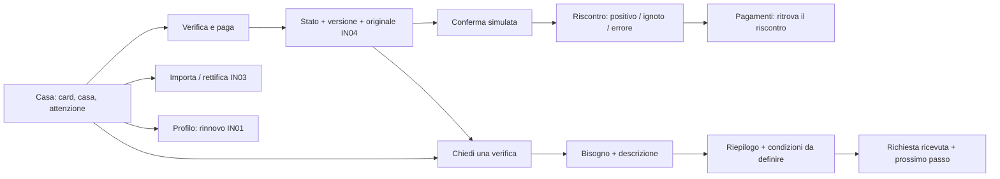

# Proposta navigabile — la casa e il prossimo passo

15 ottobre 2026. Attuazione di C33–C35 e della richiesta corrente, senza riaprire
l’analisi delle fonti. [Visione ricevuta](../visione-casa-2026-10-15/README.md).
Menu, ordine, testi e layout sono **una proposta da valutare**, non scelte definitive.

[Apri la proposta desktop/mobile](https://eecard-design-preview.uepacio.chatgpt.site/#/casa/home).
Il layout segue la larghezza dello schermo. Lo [spazio attuale](https://eecard-design-preview.uepacio.chatgpt.site/#/spazio/overview)
resta separato e contiene la vista operativa dell’agenzia. La sua home offre
un collegamento alla proposta; l’ingresso preesistente non è sostituito.
Pubblicata in Sites v11 il 16 ottobre 2026, sorgente `73d6e53`.
[PR #17](https://github.com/av3rgfx/EECard/pull/17) aperta senza merge.
Stato di pubblicazione e commit effettivo: [registro Sites](../../design/ANTEPRIME_WEB.md).

## Cosa cambia nella proposta

La tessera apre la home personale, seguita dall’azione di pagamento e dalla priorità
pertinente alla casa. La casa è identificata già in alto e ha una fotografia
espansa nella pagina; le case visibili multiple usano righe editoriali compatte.
Con un solo risultato dopo filtro la presentazione torna espansa. «Vedi immobili»
resta sempre espanso. Non ricompaiono card immobili o contenitori annidati per i form.

Il saluto promozionale lascia spazio a «Paga una bolletta» e «Chiedi assistenza».
«Da guardare adesso» spiega il bisogno, la casa, la scadenza e il prossimo passo:
lo stato ignoto è «da verificare», non un debito certo o una falsa urgenza.
Seguono casa, documenti/richieste/servizi e attività recenti. Nessun totale di
spesa inventato e nessun annual report: IN05 non è stato avviato.

C–Legame, Manrope, bruno/avorio/albicocca e materiali della tessera sono conservati.
Il simbolo resta diritto; il nome è provvisorio. Navigazione a quattro voci su
sidebar desktop e barra inferiore mobile; mappa e scenari sono dettagli di prova,
separati dalle azioni quotidiane. Nessun movimento decorativo nuovo.

## Mappa candidata

| Area | Ingresso e domanda | Azioni / ritorno |
| --- | --- | --- |
| Casa | «Cosa richiede attenzione?» | Tessera, casa corrente, priorità, documenti, richieste e forniture. Accesso diretto ai due percorsi |
| Pagamenti | «Devo verificare o pagare?» | Bollette autorizzate → controllo → conferma simulata → riscontro consultabile; ritorno a casa o all’elenco |
| Assistenza | «Di cosa ho bisogno?» | Tecnico, documento/burocrazia, bolletta, abbonamento domestico → descrizione → riepilogo → riferimento → stato |
| Profilo | «Come gestisco accesso e adesione?» | Tessera e rinnovo IN01; adesione al servizio distinta dagli abbonamenti domestici |
| Documenti e case | Accessi diretti dalla home | Documenti pertinenti alla casa, versioni e contenuto sintetico; bollette aggiornate nell’archivio dedicato |
| Agenzia | Ambiente operativo separato | Si conserva la 0.5 con coda, pratiche, controlli e incarichi. Nessuna tessera personale o allargamento dei permessi |

## Percorso bolletta

1. Home → **Verifica e paga**: Casa Luce, Energia Esempio, 84 EUR, ottobre,
   scadenza 31 ottobre 2026, versione corrente. Data di riferimento sintetica:
   14 ottobre 2026. L’originale non certifica se il dovuto sia ancora aperto.
2. **Mostra avviso e originale** riusa IN04, compresi codice non pagabile,
   storico, fonte e permessi. Chiudi/Escape riporta all’azione di origine.
3. La dichiarazione di controllo preliminare abilita il seguito solo nello
   scenario di prova. Non è un incasso verificato. Domiciliazione e pagamento
   indicato richiedono una verifica, senza proporre una seconda disposizione.
4. Riepilogo con importo, simulatore locale, metodo dimostrativo, commissioni
   reali da definire e nessun addebito. Nessun partner/canale reale è dichiarato
   disponibile. **Annulla** non crea riscontri e azzera la dichiarazione.
5. **Conferma simulazione** produce un riscontro in memoria. Positivo significa
   passaggio simulato completato, ancora da verificare. Esito ignoto impedisce
   il nuovo tentativo; errore senza disposizione consente ricontrollo e retry.
   Il selettore «Esplora un esito» appartiene alla prova, non a un pagamento reale.
6. Il riscontro si ritrova nei Pagamenti durante la visita, con riferimento,
   casa/versione ed esito del singolo tentativo. Dichiarazione, evidenza,
   incasso verificato e quietanza sono separati; nessuna scrittura nel ledger.
7. **Aggiungi / apri bollette** riusa BillsPanel IN03. Rettifica ottobre 84 → 79
   aggiorna il pagamento, conserva originale e v1; nessun duplicato del dovuto.
   Una rettifica non elimina un tentativo incerto sullo stesso oggetto.

## Percorso assistenza

Home → Chiedi assistenza, oppure «Non sono sicuro» dalla bolletta. Il secondo
percorso conserva casa, creditore, periodo e versione. Tipo di aiuto e descrizione
usano dati di esempio; il riepilogo può essere corretto o annullato. Conferma
crea una richiesta **ricevuta nella simulazione**, con riferimento, referente
ancora da assegnare e prossimo passo. Nessun professionista viene contattato,
nessuna spesa autorizzata, nessun tempo garantito.

Il titolo richieste esistente copre Casa Luce. Per Casa Atelier, che ha il solo
titolo utenze nella fixture, il percorso dichiara il limite e non salva richieste
su un’altra casa. Non abbiamo ampliato i grants per rendere cliccabile un servizio.
Lo scenario «Nessuna urgenza» mostra una richiesta già in lavorazione, con
prossimo aggiornamento da concordare e nessuna data fittiziamente confermata.

## Scenari di confronto

Aprire **Proposta · simulazione** in alto. Il cambio scenario ripristina questa
sola proposta: una casa/una priorità, più case e filtro, nessuna urgenza con
assistenza in corso, domiciliazione indicata, pagamento indicato, rettifica,
proprietario senza delega alle bollette. Le fonti degli scenari speciali sono
le fixture IN03 già esistenti, acquisite con lo stesso modello di importazione.

## Confini e riuso

`src/proposal/` aggiunge una vista isolata e un gate del pagamento simulato.
Riusa modello/policy schema 4, `readSubscription`/`work` IN01, `BillsPanel` IN03,
`BillNotice` IN04, fotografie, simbolo e Modal Base UI/Motion esistenti.
Permessi e versione vengono riletti anche alla conferma. Non aggiunge un backend,
provider, QR autentico, OCR, notifica, file privato o dipendenza runtime.

**I dati della proposta durano fino al ricaricamento o all’uscita verso lo spazio
attuale.** È un confronto navigabile, non una migrazione della piattaforma:
non scrive nelle chiavi persistenti della 0.4/0.5, non modifica i loro archivi,
rinnovi, ledger o richieste. La ripresa persistente multiutente e la riconciliazione
sono lavoro futuro, non risultati di questa proposta. L’isolamento è esplicito
nell’interfaccia. Canali/costi e copertura commerciale restano da definire.

## Valutazione successiva

Raccogliere riscontri concreti su gerarchia iniziale, collocazione dei documenti,
chiarezza di «verifica e paga», passaggio al supporto e ritorno alla casa. Decidere
poi quali parti integrare nello spazio principale. Il menu candidato non diventa
approvato perché è stato pubblicato. Non avviare automaticamente IN05.

[Verifiche e screenshot](VERIFICHE.md) distinguono automazione/emulazione da
osservazioni umane. BF02 intatto; BF16, N02/PB04 fisico e operatività restano aperti.
PR #15 e #16 verificate integrate prima del nuovo branch: base `7319587`, branch
`feat/proposta-casa`. Nessun merge dell’assistente.
